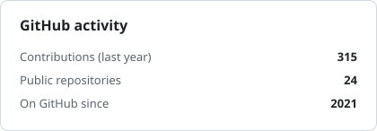
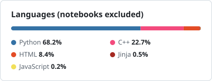

 

<h2 align="center">AI Infrastructure | GenAI | MLOps</h2>

###

###

  
  
  
  
  
  
  
  
  
  
  
  
  
  
  
  
  
  
  
  
  
  
  

 

  
  
  
  
  
  
  
  
  
  
  
  
  
  
  
  
  
  
  
  
  
  
  

 

  
  
  
  
  
  
  
  
  
  
  
  
  
  
  
  
  

###

### 👋 About me

I build the platforms that take AI from a notebook to real users on GPUs.

- ☁️ **Self-service AI cloud on your own cluster:** the customer brings Kubernetes, we install the whole platform, and it works like AWS or Run:ai.
  Universities get notebooks and GPU quotas. Businesses deploy models from a model store and sell them to their own customers. Everything is one click.
- 📚 **AI Teacher:** managed pipelines that extract textbook content, embed it and serve it from Qdrant.
- 🗣️ **Real-time talking avatars:** **42 concurrent users at 25 fps** on one GPU at ~90% SM utilization, with session-aware autoscaling so nobody gets dropped mid-session.
- 🔁 **Before that:** 13 continuous-learning Kubeflow pipelines and a KServe migration that gave +40% throughput and GPU utilization.

🎓 BS Artificial Intelligence, Gold Medalist · built Stable Diffusion from scratch, just to understand how it works.

### 🚀 Featured

| | |
|---|---|
| [**mlops-model-gateway**](https://github.com/Abubakar-00/mlops-model-gateway) | One API to train, version and deploy models on Kubeflow + KServe |
| [**kubeflow-training-pipelines**](https://github.com/Abubakar-00/kubeflow-training-pipelines) | 13 continuous-learning pipelines with full lineage and GitOps |
| [**k8s-cluster-automation**](https://github.com/Abubakar-00/k8s-cluster-automation) | Bare-metal HA Kubernetes in Ansible, tested by breaking it |
| [**Stable-Diffusion-from-Scratch**](https://github.com/Abubakar-00/Stable-Diffusion-from-Scratch) | U-Net, VAE and DDPM built from the math |

### 📊 Activity

<picture>
  <source media="(prefers-color-scheme: dark)" srcset="assets/stats-dark.svg">
  
</picture>
<picture>
  <source media="(prefers-color-scheme: dark)" srcset="assets/languages-dark.svg">
  
</picture>

###

  
  
  

